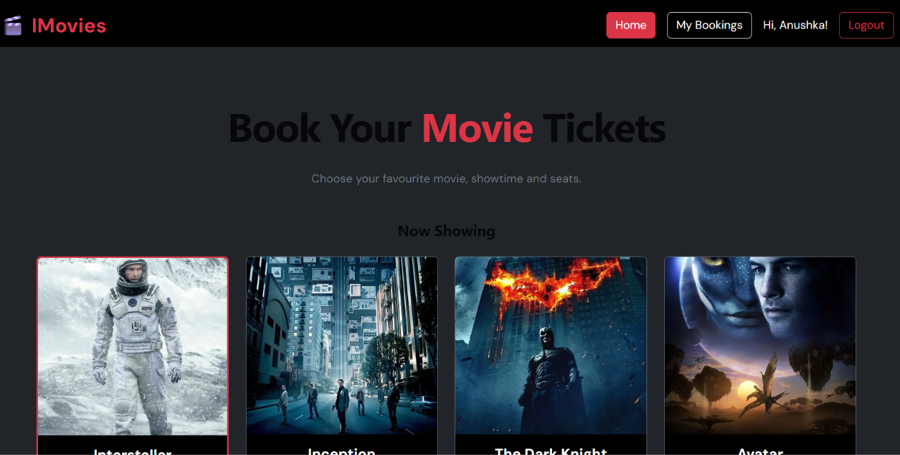
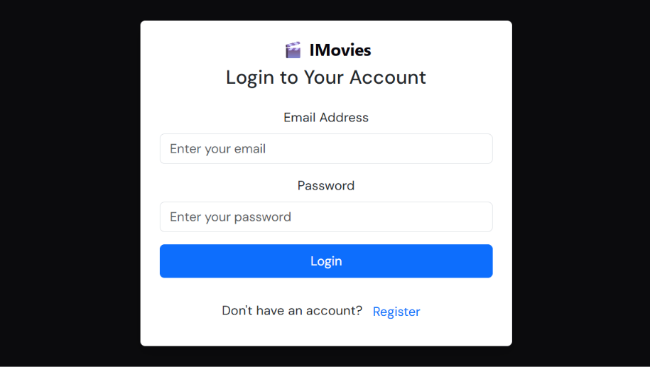
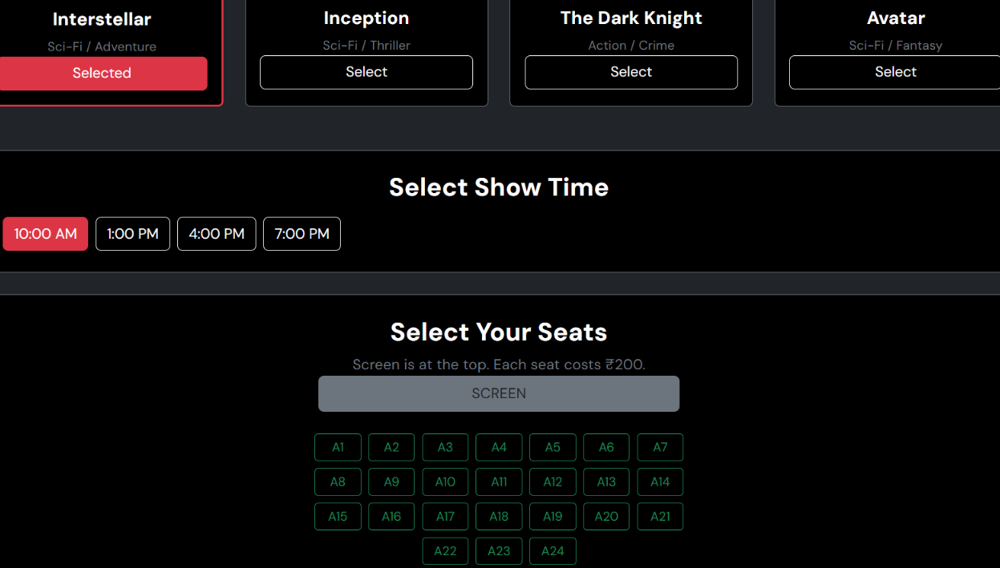
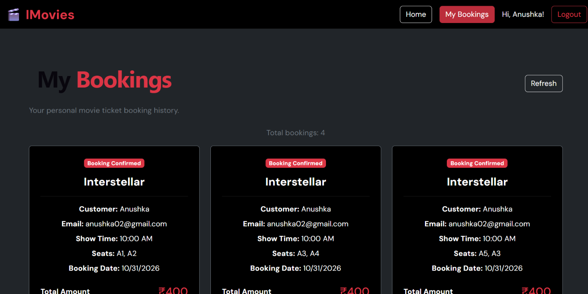

# 🎬 IMovies – Online Movie Ticket Booking System

IMovies is a full-stack web application developed to make online movie ticket booking simple, convenient, and user-friendly. Users can browse movies, select show timings, choose seats, register or log in securely, book tickets, and view their booking history.

The project is built using React.js, Node.js, Express.js, MongoDB Atlas, and JWT Authentication. It also uses Bootstrap for responsive user interface design.

## 🌐 Live Demo

**Website:** [Visit IMovies](https://imovies-theta-indol.vercel.app)

**GitHub Repository:** [View IMovies on GitHub](https://github.com/anushkaarya28/imovies)

**Backend API:** https://imovies-backend-lu6f.onrender.com

## ✨ Features

- Browse available movies.
- Select preferred movie show timings.
- Choose seats from the seating layout.
- Automatically calculate the total ticket price.
- Enter customer details for booking.
- User registration and login.
- Secure password hashing.
- JWT-based user authentication.
- Protected booking APIs.
- Book movie tickets online.
- View personal booking history in the My Bookings section.
- Store booking details in MongoDB Atlas.
- Responsive user interface using Bootstrap.

## 🛠️ Technologies Used

### Frontend
- HTML
- CSS
- JavaScript
- React.js
- Vite
- Bootstrap

### Backend
- Node.js
- Express.js
- REST API
- Asynchronous JavaScript

### Database
- MongoDB Atlas
- Mongoose

### Authentication & Security
- JSON Web Token (JWT)
- bcryptjs
- Protected API routes

### Deployment & Tools
- Git
- GitHub
- Vercel
- Render
- Visual Studio Code

## 📸 Website Screenshots

### 1. Home Page



### 2. Login and Registration Page



### 3. Movie and Seat Selection



### 4. My Bookings Page



## ⚙️ Project Working

1. Users open the IMovies website.
2. Users can register or log in to their account.
3. They browse the available movies.
4. They select a movie and preferred show time.
5. They choose their preferred seats.
6. The system calculates the total ticket amount.
7. Users confirm their booking.
8. Booking details are sent to the backend through REST APIs.
9. The backend verifies the user's JWT authentication token.
10. Booking information is stored in MongoDB Atlas.
11. Users can view their booking history in the My Bookings section.

## 🔐 Authentication System

IMovies uses JSON Web Token (JWT) for user authentication.

- Users can register and log in.
- Passwords are hashed using bcryptjs before being stored.
- JWT tokens are generated after successful registration or login.
- Protected API routes verify the authentication token.
- Users can access their own booking history after logging in.

## 📂 Project Structure

```text
IMovies/
│
├── server/
│   ├── models/
│   │   ├── Booking.js
│   │   └── user.js
│   │
│   ├── routes/
│   │   └── authRoutes.js
│   │
│   ├── middleware/
│   │   └── authMiddleware.js
│   │
│   ├── .env
│   ├── package.json
│   └── server.js
│
├── src/
│   ├── components/
│   │   └── auth.jsx
│   ├── App.jsx
│   ├── main.jsx
│   └── ...
│
├── public/
├── index.html
├── package.json
└── README.md
```

## 🚀 Run the Project Locally

### Prerequisites

Make sure the following are installed:

- Node.js
- npm
- MongoDB Atlas account
- Git

### 1. Clone the Repository

git clone https://github.com/anushkaarya28/imovies.git

### 2. Open the Project Folder

cd imovies

### 3. Install Frontend Dependencies

npm install

### 4. Install Backend Dependencies

cd server
npm install

### 5. Configure Environment Variables

Create a `.env` file inside the `server` folder and add:
env
PORT=5000
MONGODB_URI=your_mongodb_connection_string
JWT_SECRET=your_secret_key

Replace the placeholder values with your own MongoDB connection string and a strong secret key. Never upload your actual `.env` file or secret values to GitHub.

### 6. Start the Backend

From the `server` folder, run:

node server.js

The backend will run at:
http://localhost:5000

### 7. Start the Frontend

Open another terminal in the project root folder and run:

npm run dev

Open the local URL displayed in the terminal, usually:
http://localhost:5173

## 🔗 Backend API Endpoints

| Method |  Endpoint          |           Description                     |
|--------|--------------------|-------------------------------------------|
| GET    |     `/`            | Backend welcome route                     |
| GET    | `/api/health`      | Check backend health                      |
| POST   |`/api/auth/register'| Register a new user                       |
| POST   | `/api/auth/login`  | Login user                                |
| POST   | `/api/bookings`    | Create a booking (protected)              |
| GET    | `/api/bookings`    | Get logged-in user's bookings (protected) |
  
Protected endpoints require a valid JWT token in the Authorization header.

Authorization: Bearer YOUR_JWT_TOKEN

## 🎯 Skills Required & Technologies Covered

1. HTML
2. CSS
3. JavaScript
4. React.js
5. Node.js
6. Express.js
7. MongoDB
8. Asynchronous JavaScript
9. JSON Web Token (JWT)
10. Bootstrap

## 🔮 Future Enhancements

- Online payment gateway integration.
- Real-time seat availability and seat locking.
- Admin dashboard for movie and show management.
- Movie reviews and ratings.
- Email booking confirmation.
- Downloadable e-tickets.
- Advanced movie search and filtering.

## 👩‍💻 Project Information

- **Project Name:** IMovies – Online Movie Ticket Booking System
- **Developed By:** Anushka
- **Course:** B.Tech
- **Semester:** 5th Semester
- **College:** Lakshmi Narain College of Technology and Science

## 📝 Note

This project is developed for academic and learning purposes. It demonstrates full-stack web development, frontend and backend integration, REST API development, database management, JWT-based authentication, and cloud deployment.
